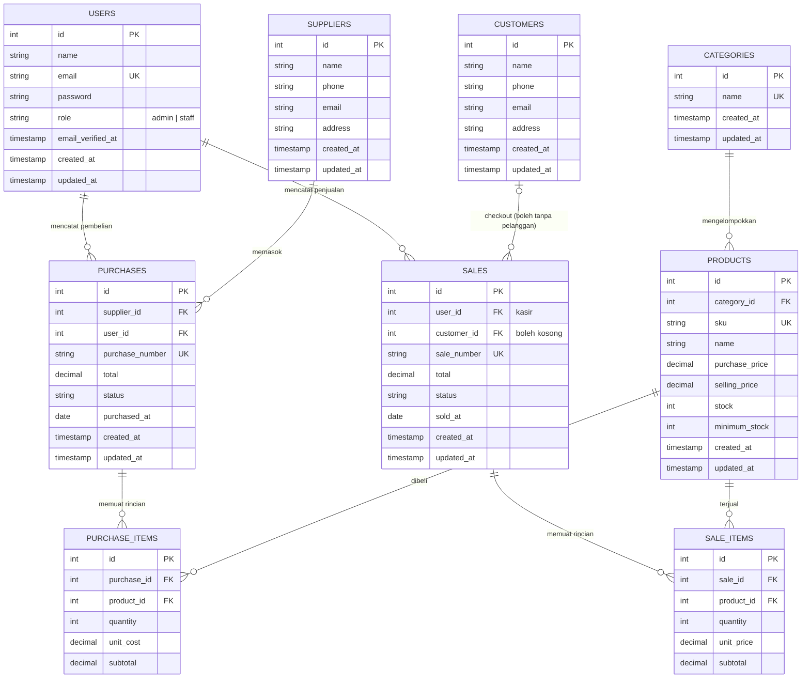

# 📐 ERD — SummitGear Outdoor

Entity Relationship Diagram database **`inventory_baru`** (MySQL), sesuai file
`database/migrations/2024_01_01_000000_create_integrated_inventory_tables.php`
dan `2026_10_26_000001_add_performance_indexes.php`.

## Penjelasan Relasi

| Relasi | Kardinalitas | Keterangan |
|---|---|---|
| `categories` → `products` | 1 : N (nullable) | Setiap produk opsional dimiliki satu kategori (`products.category_id`). |
| `users` → `purchases` | 1 : N | Admin/staff yang mencatat pembelian barang (`purchases.user_id`). |
| `suppliers` → `purchases` | 1 : N | Barang dibeli dari supplier tertentu (`purchases.supplier_id`). |
| `purchases` → `purchase_items` | 1 : N | Satu pembelian berisi banyak baris barang (`purchase_items.purchase_id`). |
| `products` → `purchase_items` | 1 : N | Item pembelian merujuk produk (`purchase_items.product_id`, `unit_cost`). |
| `users` → `sales` | 1 : N | Admin/staff bertindak sebagai kasir (`sales.user_id`). |
| `customers` → `sales` | 0..1 : N | Pelanggan opsional; transaksi walk-in dapat tanpa customer (`sales.customer_id` nullable, ON DELETE SET NULL). |
| `sales` → `sale_items` | 1 : N | Satu penjualan berisi banyak baris barang (`sale_items.sale_id`). |
| `products` → `sale_items` | 1 : N | Item penjualan mengunci harga saat transaksi (`unit_price` disalin dari `selling_price`). |

## Catatan Skema

- **Role pengguna hanya `admin` dan `staff`** — tidak ada role pelanggan; data pembeli disimpan di tabel `customers`.
- Kolom `status` pada `purchases` mengikuti alur pembelian (`pending` → `completed`), sedangkan `status` pada `sales` bernilai `completed`/`cancelled`.
- Tabel `sales` pada SummitGear **tidak memiliki kolom `payment_method`** (pencatatan kasir tunai).
- **Alur stok**: stok produk bertambah ketika pembelian item selesai (diproses `PurchaseService`), berkurang ketika penjualan selesai (diproses `SaleService`, dengan validasi anti-oversell). Jika penjualan dibatalkan, stok dikembalikan.
- Nomor dokumen unik: `sales.sale_number` (`SG-YYYYMMDD-XXXXX`) dan `purchases.purchase_number` (`PO-YYYYMMDD-XXXXX`), dibuat otomatis lewat service.
- Indeks performa tambahan (migration `2026_10_26_000001`) pada kolom `products.sku`, `sales.sold_at`, `sale_items.sale_id`, `purchase_items.purchase_id`, dsb. agar filter/laporan lebih cepat.
- Harga (`purchase_price`, `selling_price`, `unit_cost`, `unit_price`, `total`, `subtotal`) memakai tipe `decimal(12,2)` dalam Rupiah.
