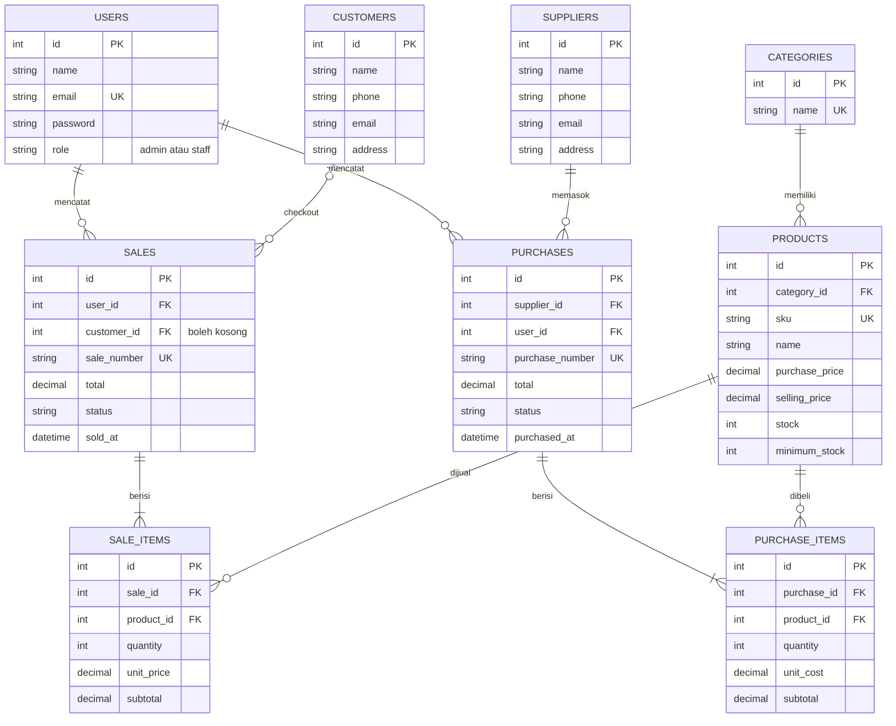

# SummitGear Outdoor — Inventory & Sales Management System

Aplikasi manajemen stok dan penjualan berbasis **Laravel 9 + MySQL**
**(Web Programming 2 — UTS Integrated Laravel Project)**.
Mencatat master data, pembelian (stock-in), dan penjualan (stock-out) dengan
**konsistensi stok yang dijaga database transaction**, serta pembatasan hak
akses **Admin/Owner** dan **Staff** yang ditegakkan di sisi server.

> Fokus aplikasi: **konsistensi stok, transaksi yang benar, dan otorisasi nyata** —
> bukan sekadar CRUD tampilan.

---

## 1. Project overview

| Modul | Keterangan |
|---|---|
| Authentication | Login/logout, password di-hash (bcrypt), session regenerate |
| Role access | Admin/Owner & Staff via **Gate + middleware `can:`** (server-side) |
| Master data | Kategori, Produk (SKU unik), Pemasok, Pelanggan, Pengguna |
| Purchases | Header + banyak item; stok **bertambah** setelah transaksi sukses |
| Sales | Header + banyak item; stok **berkurang**; ditolak bila stok kurang |
| Pembatalan | Admin saja; stok dipulihkan konsisten; tidak bisa dibatalkan dua kali |
| Dashboard | Penjualan hari/bulan ini, jumlah transaksi, produk, stok rendah, tren 7 hari (query agregat) |
| Search/report | Cari SKU/nama/nomor, filter kategori/status/tanggal, pagination dengan query terjaga |

**Pengguna:** Admin/Owner dan Staff dengan izin berbeda (lihat tabel hak akses di bawah).

---

## 2. Requirements

- PHP >= 8.0.2 (ekstensi `pdo_mysql`, `mbstring`, `openssl`)
- Composer 2
- MySQL/MariaDB (atau XAMPP bawaan)
- Node.js **tidak wajib**: seluruh aset CSS sudah siap di `public/css` dan font via CDN

## 3. Installation

```bash
git clone <repository-url>
cd inventory-laravel
composer install
cp .env.example .env     # (Windows: copy .env.example .env)
php artisan key:generate
```

## 4. Environment setup

Buat database kosong (contoh `inventory_sales`), lalu sesuaikan `.env`:

```
DB_CONNECTION=mysql
DB_HOST=127.0.0.1
DB_PORT=3306
DB_DATABASE=inventory_sales
DB_USERNAME=root
DB_PASSWORD=
```

Zona waktu (WIB) dan bahasa Indonesia sudah diatur di `config/app.php`.
Kredensial hanya disimpan di `.env` (tidak di-commit); yang di-commit hanya
`.env.example`.

## 5. Migration & seeding

```bash
php artisan migrate --seed          # database baru
php artisan migrate:fresh --seed    # reset total (menghapus semua data!)
php artisan serve                   # http://localhost:8000
```

Semua migration memiliki **guard** (`hasTable`/`hasColumn`), sehingga menjalankan
`migrate` pada database yang sudah ada tidak menghapus data. Seeder
(`DatabaseSeeder`) menyiapkan: akun demo, 4 kategori, pemasok, dan produk sample
dengan stok rendah — dibuat dengan `firstOrCreate` agar aman dijalankan ulang.

## 6. Demo account (data dummy, bukan kredensial asli)

| Role | Email | Password |
|---|---|---|
| Admin / Owner | admin@summitgear.com | password |
| Staff Kasir | staff@summitgear.com | password |

## 7. Features

### Hak akses di-tegakkan di server

| Aksi | Admin | Staff |
|---|---|---|
| Kelola pengguna & role | Ya | Tidak (403) |
| CRUD kategori, produk, pemasok | Ya | Tidak (403) |
| Lihat produk & stok rendah | Ya | Ya |
| Buat pembelian & penjualan | Ya | Ya |
| Lihat transaksi | Semua | Hanya miliknya |
| Batalkan transaksi | Ya | Tidak (403) |
| Dashboard & laporan | Penuh | Terbatas (milik sendiri) |

### Business rules

1. **SKU unik** (validasi + unique index database).
2. Kuantitas > 0, harga >= 0, semua divalidasi di server.
3. Penjualan tidak boleh melebihi stok.
4. Harga & total **dihitung server** dari database; input `total`/`unit_price`/`unit_cost`
   penjualan dari browser diabaikan.
5. Header, item, dan perubahan stok disimpan dalam satu `DB::transaction`;
   produk dikunci `lockForUpdate` (anti overselling pada request paralel).
6. Transaksi selesai tidak dapat diedit; hanya **dibatalkan** (Admin).
   Pembatalan pembelian ditolak bila stok sudah terpakai penjualan.
7. Produk/pemasok/kategori/pelanggan yang sudah dipakai transaksi
   **tidak dapat dihapus** (dilindungi oleh pengecekan di controller; pesan jelas).
8. Nomor transaksi unik per dokumen (`PUR-...`/`SALE-...`).
9. Index pada kolom `status` dan tanggal transaksi untuk query filter/laporan.

## ERD

Skema lengkap beserta penjelasan relasi tiap tabel ada di **[ERD.md](ERD.md)**.
Ringkasannya:



**Relasi Eloquent**: `Category hasMany Product`, `Product belongsTo Category`,
`Supplier hasMany Purchase`, `Purchase belongsTo Supplier`,
`Purchase hasMany PurchaseItem`, `User hasMany Sale/Purchase`,
`Customer hasMany Sale`, `Sale hasMany SaleItem`, dst.
Foreign key berada di tabel detail (sisi `belongsTo`) —  jelaskan saat demo:
satu baris induk dirujuk banyak baris anak.

Menghindari **N+1 query**: daftar memakai eager loading,
contoh `Product::with('category')->paginate(10)`.

## Arsitektur

`Route → Middleware (auth, can) → Controller → Validation → Eloquent (DB::transaction) → MySQL → Blade`

```
app/Http/Controllers   app/Http/Middleware    app/Models   app/Providers
database/migrations    database/seeders       resources/views            routes/web.php
```

## Tema tampilan

Tampilan memakai identitas **tema pegunungan** agar berbeda dari aplikasi sejenis:

- **Topbar navigasi horizontal** bertaut gradasi hijau (`#0B3D24 → #1E7A47`) lengkap dengan dropdown *Master* dan *drawer* untuk layar ponsel — bukan sidebar klasik.
- Font **Plus Jakarta Sans** (judul) dan **Inter** (isi) via Google Fonts; CSS kustom ada di `public/css/summitgear.css`.
- Halaman login gelap memakai nuansa ubin pegunungan; kartu statistik dashboard dengan aksen hijau.
- Komponen UI kustom: pagination `pagination::summit`, kartu "aksi cepat", tombol **Restock cepat**, badge status berwarna.

## Pages

- **Auth & umum**: Login, Dashboard (statistik, aksi cepat, grafik 7 hari)
- **Master data**: Produk (index/create/edit/detail), Kategori, Pemasok, Pelanggan, Pengguna (Admin), Stok rendah
- **Transaksi**: Pembelian list/create/detail, Penjualan list/create/detail, multi-item per transaksi, status transaksi
- **Fitur khas**: tombol **"Restock cepat"** di halaman Stok rendah — membuka form pembelian dengan produk & harga beli terisi otomatis (`/purchases/create?product={id}`)
- **Usability**: pencarian & filter (nomor, kategori, status, rentang tanggal), pagination kustom dengan query terjaga, pesan sukses/error

## Testing

Skenario pengujian minimal (rubrik UTS) sudah dijalankan manual
sebagai **bukti hasil pengujian**:

| # | Skenario | Hasil |
|---|---|---|
| 1 | Guest membuka /dashboard | Redirect ke login (middleware `auth`) |
| 2 | Password salah | Ditolak, pesan "Email atau password salah" |
| 3 | SKU duplikat | Ditolak pesan "SKU sudah dipakai produk lain" |
| 4 | Harga negatif | Ditolak validasi `min:0` |
| 5 | Pembelian 3 unit | Stok bertambah 3 (DB terverifikasi via tinker) |
| 6 | Penjualan 1 unit | Stok berkurang 1 |
| 7 | Penjualan melebihi stok | Ditolak; **tidak ada perubahan data** |
| 8 | Batal pembelian & penjualan | Stok pulih konsisten (10 → 13 → 12 → 10), status `cancelled`, tidak dapat dibatalkan dua kali |
| 9 | Staff akses /users & /categories | `403` (gate `manage-users`/`manage-master`) |
| 10 | Staff melihat transaksi | Hanya miliknya sendiri (scope `user_id`) |
| 11 | Filter status/tanggal + pagination | data sesuai filter, query tetap terjaga |

## Known limitations

- Tidak ada payment gateway, multi-gudang, akuntansi penuh, multi-currency, aplikasi mobile, atau integrasi ERP (di luar ruang lingkup UTS).
- Pembatalan pembelian berjalan asinkron dengan penjualan: stok mungkin sudah terpakai — sistem menolak dan memberi pesan.
- Nomor dokumen mengandung komponen `rand()`; tabrakan diatasi oleh unique index + kegagalan transaksi (rollback). Untuk volume tinggi gunakan generator berbasis DB.
- Total penjualan hari ini mengikuti zona waktu server (`Asia/Jakarta`).

## Integrity

- Semua data dummy. Tidak ada kredensial pribadi atau API key di repo.
- Atribusi: struktur & snippet Laravel mengikuti dokumentasi resmi Laravel.
